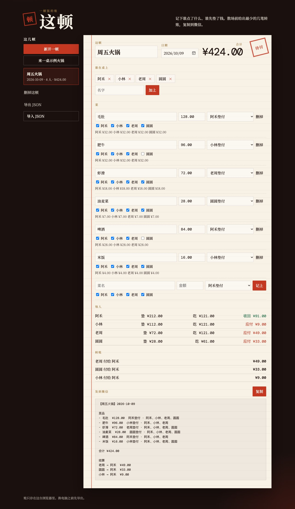

# 这顿

一顿饭吃完，谁垫了多少、谁该给谁，当场算清。

打开 [`index.html`](index.html) 就能用。账记在这台浏览器里，不经过服务器。



A local page for splitting one meal. It turns “who paid for which dish, and who ate it” into the fewest transfers you can paste into a group chat.

## 什么时候用

几个人一起吃饭，有人先付钱。菜不是人人都吃。散场前要在微信里说清楚谁转给谁。

## 怎么用

1. 写下谁在桌上。
2. 每道菜记三件事：多少钱、谁垫的、谁吃了。垫的人可以自己没吃。
3. 底下是合并过的转账。点「复制」，贴到微信。

左边可以留下好几顿。想先看效果，点「来一桌示例火锅」。那一桌合计 ¥424.00。

换浏览器之前点「导出 JSON」。导出来的文件可以再导入。

## 钱怎么算

金额用「分」做整数。一道菜如果除不尽，多出来的几分钱不会总落在同一个人头上：谁这顿已经多承担了分，下一道就排到后面。

转账按净额合并。三个人互相垫过，不会让你转三圈，只留下付得清的最少几笔。

没选「谁吃了」或「谁垫的」的菜会标成未入账，不进结算，免得账平不了。

举例：阿禾垫了 100 元锅底，和小林两人吃。小林付给阿禾 ¥50.00。

## 隐私

数据在浏览器的 `localStorage`，键名 `zhedun.v1`。没有账号。

## 测试

```bash
node --test
```

## 许可

[MIT](LICENSE)
